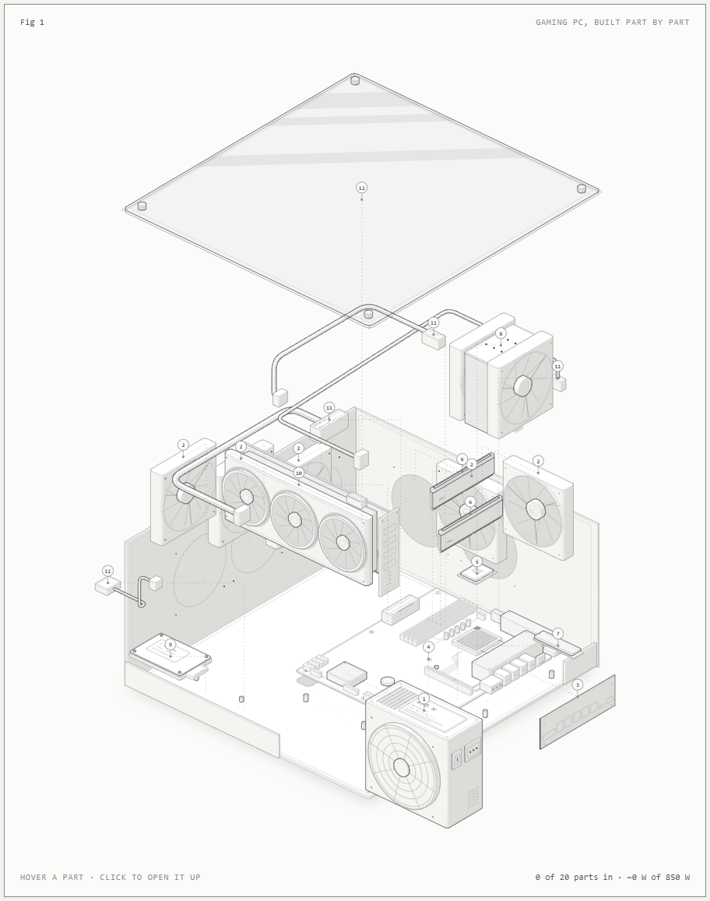
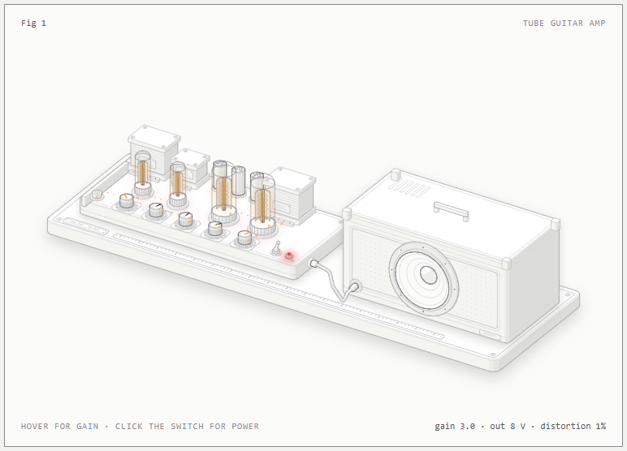

# anatomy-figures

Interactive isometric SVG figures that explain a technical idea as a real, exploded object. Built with the
anatomy skill for Claude Code: framework-free Node build scripts that write standalone HTML pages.

| Figure | What it shows | Open |
|---|---|---|
| [gaming-pc](gaming-pc/) | A gaming PC in 20 assemblies / 274 parts, exploded in build order; click a part to open it up | `gaming-pc/gaming-pc.html` (also `-dark`, `-blueprint`) |
| [tube-amp](tube-amp/) | A tube guitar amp: signal chain, glowing tubes, a cone that follows the waveform | `tube-amp/tube-amp-light.html`, A4 PDFs alongside |




## Building

The build scripts import the anatomy kit from `C:/Users/brand/.claude/skills/anatomy` (the `SKILL` constant at the top of
each `build.mjs` and `gaming-pc/world.mjs`). Change that path if the skill lives elsewhere, then:

```sh
cd gaming-pc && node build.mjs     # writes the three theme pages and leaves.json
node check.mjs                     # replays every explode/assemble path; fails if parts pass through each other
node cycles.mjs apart              # painter's-order check for a pose (apart | built | step:N)
```

`gaming-pc/layout.json` holds where each assembly goes when exploded; `node setmoves.mjs` writes it into `pc.mjs`.
Wattages in the gaming PC are typical gaming-load estimates for generic parts, not one product.
